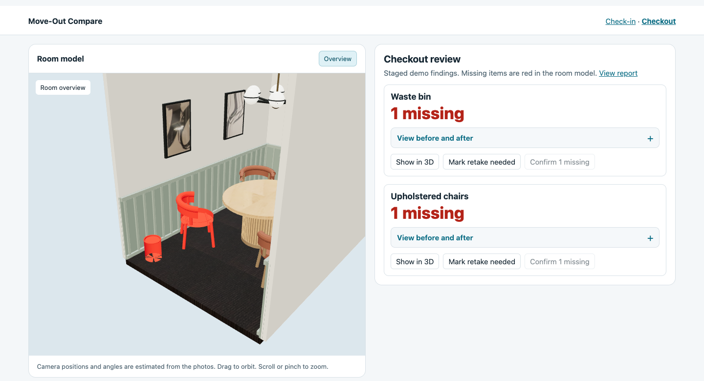
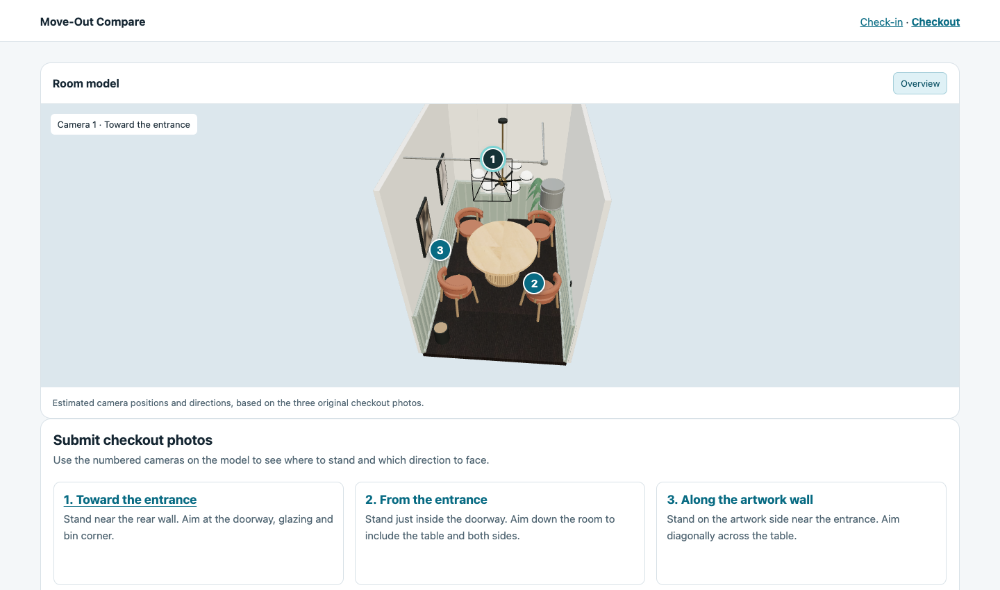
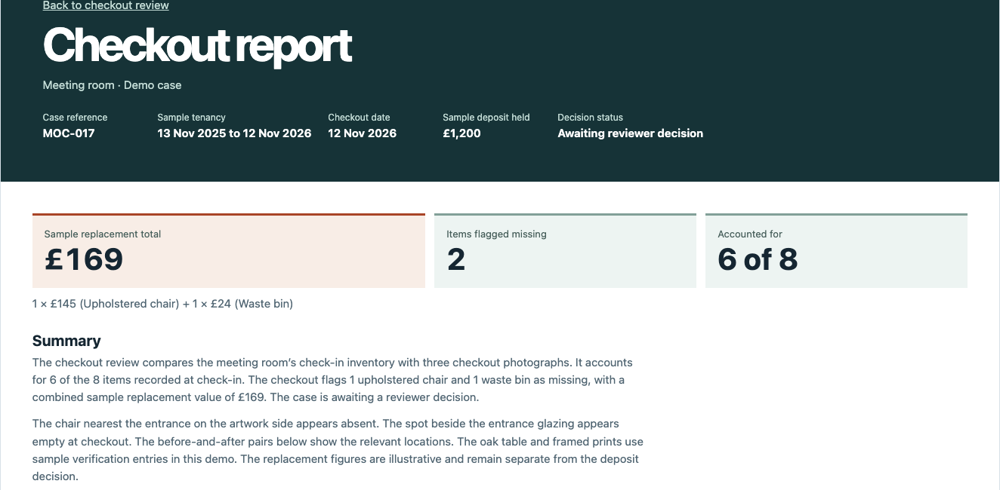

# RightView

RightView is a 3D property inspection dashboard for landlords and tenants. It connects the move-in inventory, guided checkout photos, and an itemised report to the same interactive 3D model.

[Watch the RightView demo on YouTube](https://youtu.be/WJsXWvt6EZI)



## Walk through an inspection

1. **Check in.** Explore the room in 3D or walk through it with WASD and mouse look. Select an inventory item to inspect its recorded condition, reference photo, and value.
2. **Capture checkout.** Use three camera markers in the room model to see where to stand and which way to face. Add all three photos through a single upload control.
3. **Review and report.** See missing items highlighted together in red. Select an item to locate it in the model and expand its before-and-after evidence. The checkout report brings the findings, itemised replacement values, and evidence together for review.

## Demo views

| Guided capture | Checkout report |
| --- | --- |
|  |  |

[Download the room model (GLB, 3 MB)](assets/room-preview.glb). The preview includes the room and furnishings with solid-color materials.

## How it works

- **3D scene.** Three.js renders a textured glTF room. Viewpoints store a position, look target, and vertical field of view. Raycasting maps model selections to inventory entries.
- **Evidence and reporting.** Inventory IDs tie together mesh highlights, item counts, reference photos, and report rows. The report totals follow the review state, and inventory counts persist in browser storage.
- **Packaging.** esbuild bundles the JavaScript. The build embeds the room model and evidence assets in a single HTML file. The dashboard runs in the browser without a server.

## Run locally

Use Node.js 18 or later. Supply the matching GLB at `assets/room.glb` and the four JPEGs named in [the viewpoint manifest](assets/photo-viewpoints.json) in `assets/photos/`. Put three checkout JPEGs in `assets/photos/tenant-pics/`, named in capture order so they sort correctly. The photo set and textured model are kept outside version control. To use the public model, copy `assets/room-preview.glb` to `assets/room.glb`.

```sh
npm install
npm run build
```

Open `dist/dashboard.html` in a WebGL-capable browser. If your photos are elsewhere, pass their directory with `npm run build -- /path/to/photos`.
